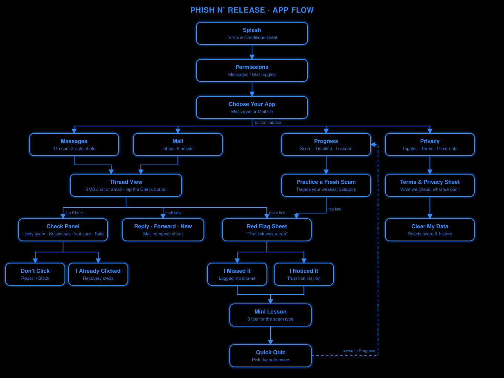

<div align="center">


# Phish n’ Release

**Don’t take the bait.** A scam-spotting coach that lives inside your messages and inbox.

Built for HackUTD: ZeroDay · T-Mobile Scam & Fraud Protection track

</div>

---

## What it is

Phish n’ Release looks like a real Messages app and Mail app, filled with a mix of scams, near-scams, and legitimate messages. Tap **Check** on any message to get an honest verdict and a plain-English reason. Tap a risky link and the app catches you mid-click, shows the red flag you missed, then teaches you with a short lesson and quiz.

## Features

- **Check on demand:** nothing is analyzed until you tap Check
- **Honest verdicts:** Likely scam, Suspicious, Not sure, or Looks safe (never "100%")
- **Red-flag trap:** tap a bad link and see exactly what gave it away
- **Lessons and quizzes** for 6 scam types: carrier, package, bank, prize, fake job, account locked
- **Adaptive practice** that targets the scams you miss most
- **Progress:** score ring, streak, and a timeline of missed scams
- **"I already clicked" recovery guide** and one-tap reporting
- **Privacy first:** no backend, no accounts, data stays on your device
- Light and dark mode

## App flow

<div align="center">
  
</div>

## Run it

No install or build step. Just open `index.html` in a browser (use mobile view on a laptop), or serve it:

```bash
python3 -m http.server
```

To host it, push to GitHub and turn on **Settings → Pages → Deploy from branch → main / root**.

## Quick demo

1. Tap **Get Started**, keep Messages and Mail on, then **Continue**
2. Open **Messages → T-Mobile** and press **Check**
3. Tap the link, pick *I missed it*, and take the lesson and quiz
4. Open **Progress** to see your score, then try **Practice a Fresh Scam**
5. Open **Mail** and compare the fake offer (Northbridge) with the real one (Brightwell)

## Tech

HTML, CSS, and vanilla JavaScript in a single file. Progress is saved in `localStorage`. No dependencies and no API keys.

## Roadmap

- Live AI coach (Gemini) for conversational lessons and fresh practice scams
- Monthly or random simulated phishing drills
- Browser extension "precheck" bar for real email

## License

MIT. See [LICENSE](LICENSE).
