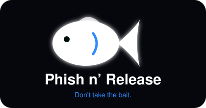

<div align="center">

  

# Phish n’ Release

**Don’t take the bait.** A scam-spotting coach that lives inside your messages and inbox.

[](#-about-the-project)
[](#-about-the-project)
[](LICENSE)


[View Demo](https://YOUR_USERNAME.github.io/YOUR_REPO/) · [Demo Video](#-screenshots) · [Report Bug](https://github.com/YOUR_USERNAME/YOUR_REPO/issues) · [Request Feature](https://github.com/YOUR_USERNAME/YOUR_REPO/issues)

</div>

<br />

## 📔 Table of Contents

- [About the Project](#-about-the-project)
- [App Flow Diagram](#-app-flow-diagram)
- [Screenshots](#-screenshots)
- [Tech Stack](#-tech-stack)
- [Features](#-features)
- [Color Reference](#-color-reference)
- [Environment Variables](#-environment-variables)
- [Getting Started](#-getting-started)
  - [Prerequisites](#️-prerequisites)
  - [Installation](#️-installation)
  - [Running Tests](#-running-tests)
  - [Run Locally](#-run-locally)
  - [Deployment](#-deployment)
- [Usage](#-usage)
- [Roadmap](#-roadmap)
- [Contributing](#-contributing)
- [Code of Conduct](#-code-of-conduct)
- [FAQ](#-faq)
- [License](#️-license)
- [Contact](#-contact)
- [Acknowledgements](#-acknowledgements)

---

## 🌟 About the Project

Most scam-awareness tools are a boring training video you watch once and forget. **Phish n’ Release** teaches you in the exact place scams actually happen: your text messages and your email inbox.

The app looks and feels like a real iMessage-style Messages app and an iOS-style Mail app, filled with a realistic mix of **scams, near-scams, and legitimate messages**. You tap the **🛡 Check** button on any message and get an honest verdict with a plain-English reason. If you tap a risky link, the screen doesn’t just punish you. It **catches you mid-click, points out the exact red flag you missed, and turns it into a 60-second lesson and quiz.**

> **The idea in one sentence:** instead of telling people what scams look like, we let them get “phished” safely, then coach them so it never happens for real.

### Why it stands out

| Problem | Our answer |
|---|---|
| Training is boring and gets forgotten | Learning happens at the moment of the mistake, inside a familiar app |
| Detectors say “SCAM!” with fake certainty | We say *Likely scam*, *Suspicious*, *Not sure*, or *Looks safe*. Never “100%”. |
| Tools that over-flag train people to ignore them | Legit lookalikes (CVS pickup, Google codes, a real internship offer) prove we don’t cry wolf |
| Privacy fears about scanning messages | Nothing is scanned until you tap Check, everything stays on-device |
| One-size-fits-all lessons | Practice scams adapt to the category you miss most |

**Built for:** [HackUTD: ZeroDay](https://hackutd.co) · **Primary track:** T-Mobile Scam & Fraud Protection

---

## 🗺️ App Flow Diagram

Every screen, and where it can take you:

<div align="center">
  
</div>

**Reading the map**

- **Splash → Permissions → Choose Your App** is the one-time onboarding. The user decides what the app is allowed to look at.
- The **bottom tab bar** (Messages · Mail · Progress · Privacy) is available everywhere after onboarding. Tabs only appear for the apps the user enabled.
- **Thread View** is the heart of the app. From it, the user can run a **Check**, reply or forward (mail), or tap a link.
- **Red Flag Sheet** is the signature moment. It leads to a **Mini Lesson → Quick Quiz**, and quiz results flow back into **Progress**.

---

## 📷 Screenshots

<div align="center">

| Onboarding | Messages | Check Panel |
|:---:|:---:|:---:|
|  |  |  |

| Red Flag Sheet | Mail | Progress |
|:---:|:---:|:---:|
|  |  |  |

**🎬 [Watch the 2-minute demo video](https://YOUR_DEMO_VIDEO_LINK)**

</div>

> 📌 Drop your screenshots into `docs/screenshots/` using the filenames above.

---

## 👾 Tech Stack

<details open>
<summary><b>Client</b></summary>

- **HTML5**: single-file app, no build step
- **CSS3**: custom properties for light/dark theming, `conic-gradient` progress ring, `color-mix()`, CSS animations, bottom-sheet modals
- **Vanilla JavaScript (ES6+)**: tiny state-driven renderer, inline SVG icons, zero frameworks
- **[Sora](https://fonts.google.com/specimen/Sora)** via Google Fonts

</details>

<details open>
<summary><b>Server</b></summary>

- **None.** The whole app is client-side and static. There is no backend that can leak your messages, because there isn’t one.

</details>

<details open>
<summary><b>Database</b></summary>

- **`localStorage`** (on-device only) for score, streak, missed-scam timeline, and learned topics
- Falls back to in-memory state if storage is unavailable

</details>

<details open>
<summary><b>DevOps</b></summary>

- **GitHub** for source control
- **GitHub Pages** for hosting
- **QR code** so judges can open the live demo on their own phone in seconds

</details>

---

## 🎯 Features

### 🛡️ Check, on your terms
Nothing is analyzed until you tap **Check**. Each result has a color-coded verdict chip and a one-line reason:

| Verdict | Meaning |
|---|---|
| 🔴 **Likely scam** | Multiple strong red flags (urgency + fake link + payment demand) |
| 🟠 **Suspicious** | Pressure tactics or too-good-to-be-true offers |
| 🔵 **Not sure** | Can’t verify the sender. Tells you *how* to check (e.g. ask a mutual friend) |
| 🟢 **Looks safe** | Sender and link match, nothing urgent or financial |

### 🪤 The “That link was a trap” moment
Tap a risky link and a sheet slides up with the **exact red flag** (for example, `chase-secure-verify.com`, not `chase.com`) and a rule to remember. You then answer honestly: *I missed it* or *I noticed it*. Both paths are judgment-free (“Logged, no shame”).

### 🎓 60-second lessons + quizzes
Six scam families, each with three tips and a real-feeling quiz:
`Carrier impersonation` · `Package delivery` · `Bank alert` · `Prize or gift card` · `Fake job offer` · `Account locked`

### 🎯 Adaptive practice
**Practice a Fresh Scam** targets whichever category you’ve been caught by most, and alternates between SMS and email so you train on both.

### 📈 Scam-spotting score
A progress ring (% spotted), a current streak, missed-scam **timeline** with one-tap lessons, and a “What you’ve learned” topic list.

### 🧠 Smart safe-message handling
A real internship offer, a CVS pickup text, a Google verification code, and a Spotify receipt are all **correctly marked safe**, with reasons. This is how the app earns your trust.

### 🆘 “I already clicked” recovery
A calm, step-by-step panic-button sheet: don’t enter details, change passwords, call your bank, and report to the FTC.

### 🚩 One-tap reporting
Texts: forward to **7726 (SPAM)**. Emails: forward to **reportphishing@apwg.org**. Plus Block and Don’t Click actions.

### 🔒 Privacy by design
Per-app permission toggles, transparent Terms sheet, one-tap **Clear my data**, and honest confidence language.

### 🌗 Polish
Light/dark mode toggle, realistic iMessage + iOS Mail look and feel, smooth animations, and a mobile-first layout that frames itself as a phone on desktop.

---

## 🎨 Color Reference

| Color | Hex | Used for |
|---|---|---|
| Midnight (Background) |  `#05070d` | App background (dark mode) |
| Card |  `#0f1626` | Cards, sheets |
| Line |  `#1f2b45` | Borders, dividers |
| **Primary Blue** |  `#2f8bff` | Buttons, glow, accents |
| Text |  `#ffffff` | Primary text |
| Muted |  `#8b95a9` | Secondary text |
| Scam Red |  `#ff4d5e` | “Likely scam” |
| Suspicious Amber |  `#ffb020` | “Suspicious” |
| Not-sure Sky |  `#8ab4ff` | “Not sure” |
| Safe Green |  `#2ee59d` | “Looks safe” |

---

## 🔑 Environment Variables

**None required.** 🎉 Phish n’ Release is a static, key-free app: no `.env`, no secrets, nothing to leak.

---

## 🧰 Getting Started

### ‼️ Prerequisites

Just a modern browser (Chrome, Safari, Edge, Firefox). Optionally, any static file server if you prefer not to open the file directly:

```bash
# Option A: Python (already installed on most machines)
python3 -m http.server

# Option B: Node
npx serve
```

### ⚙️ Installation

```bash
git clone https://github.com/YOUR_USERNAME/YOUR_REPO.git
cd YOUR_REPO
```

No `npm install`, no build step. That’s the whole point.

### 🧪 Running Tests

There’s no automated suite yet (it’s a 24-hour hackathon build 😅). Use this 2-minute manual check:

- [ ] Splash: “Get Started” is disabled until Terms are checked
- [ ] Permissions: turning both toggles off disables **Continue**
- [ ] Messages: Check **T-Mobile** → *Likely scam*; **Amazon** → *Looks safe*; **+1 (469)…** → *Not sure*
- [ ] Tap a scam link → Red Flag sheet → *I missed it* → Lesson → Quiz → score updates in **Progress**
- [ ] Mail: Check **Northbridge Talent Team** → *Likely scam*; **Brightwell Recruiting** → *Looks safe*
- [ ] Progress → **Practice a Fresh Scam** works for SMS and Mail
- [ ] Privacy → **Clear my data** resets the score ring
- [ ] Theme toggle (top right) switches light/dark

### 🏃 Run Locally

1. Clone the project
   ```bash
   git clone https://github.com/YOUR_USERNAME/YOUR_REPO.git
   ```
2. Go to the project directory
   ```bash
   cd YOUR_REPO
   ```
3. Open it
   ```bash
   open index.html          # macOS
   # or: start index.html   # Windows
   # or: python3 -m http.server  → http://localhost:8000
   ```

> 💡 For the best view on a laptop, use your browser’s **device toolbar** (mobile mode). On a real phone it fills the screen.

### 🚩 Deployment

Deploy for free with **GitHub Pages**:

1. Push the code to a GitHub repo (`index.html` at the root)
2. Go to **Settings → Pages**
3. Under **Source**, choose **Deploy from a branch**, select `main` and `/ (root)`
4. Your demo goes live at `https://YOUR_USERNAME.github.io/YOUR_REPO/`
5. Generate a QR code of that URL so judges can scan and try it on their own phones

---

## 👀 Usage

### 60-second judge walkthrough

1. **Scan the QR code** and tap **Get Started**.
2. **Choose what we check.** Leave **Messages** and **Mail** on, and notice that nothing is scanned yet.
3. Open **Messages** → tap **T-Mobile** → press **Check** → see *Likely scam* with the reason.
4. **Tap the link** → the red-flag sheet appears → choose *I missed it* → take the **lesson and quiz**.
5. Open **Progress** → watch your scam-spotting ring and timeline update → hit **Practice a Fresh Scam**.
6. Open **Mail** → compare **Northbridge** (fake offer) with **Brightwell** (real offer).

### How verdicts are modeled

Each message in the demo carries its own structured result, which keeps the demo deterministic and judge-proof:

```js
{
  id: 'tmo',
  n: 'T-Mobile',
  cat: 'Carrier impersonation',   // maps to a lesson + quiz
  lvl: 'scam',                    // scam | sus | unsure | safe
  why: 'Urgent language, plus a link that doesn’t match the real company.',
  m: [['th', 'T-Mobile: Your bill is 2 days overdue. Pay within 1 hour ...']]
}
```

Adding a new scam family means adding one entry to `LS` (tips, red flag, quiz) and one message to `T`.

---

## 🧭 Roadmap

- [x] iMessage-style Messages app with realistic scam + safe threads
- [x] iOS-style Mail app with inbox, threads, reply/forward
- [x] Check panel with four honest confidence levels
- [x] Red-flag trap, lessons, quizzes, and recovery guide
- [x] Score ring, streak, and missed-scam timeline
- [x] Light / dark mode
- [x] Adaptive practice scams for SMS and Mail
- [ ] 🤖 Live AI coach (Gemini) that explains red flags conversationally and generates fresh practice scams
- [ ] 🔎 Real on-device classifier for pasted or forwarded messages
- [ ] 📅 Monthly / random simulated phishing drills
- [ ] 🧩 Browser-extension “precheck” bar for real email
- [ ] 👨‍👩‍👧 Family mode for parents and grandparents
- [ ] 🌍 Multi-language lessons

---

## 👋 Contributing

Contributions are always welcome!

See [`CONTRIBUTING.md`](CONTRIBUTING.md) for ways to get started. Quick version:

1. Fork the repo
2. Create your branch (`git checkout -b feature/amazing-feature`)
3. Commit your changes (`git commit -m 'Add amazing feature'`)
4. Push (`git push origin feature/amazing-feature`)
5. Open a Pull Request

---

## 📜 Code of Conduct

Please read the [Code of Conduct](CODE_OF_CONDUCT.md).

---

## ❔ FAQ

- **Does this read my real texts or emails?**

  No. This demo uses **fake messages and synthetic data**. In a real deployment, nothing would be scanned until the user taps Check, and personal details would be hidden first.

- **Where is my score stored?**

  Only in your browser’s local storage on your device. Use **Privacy → Clear my data** to wipe it.

- **Why “Not sure” instead of just scam or safe?**

  Because honesty builds trust. If we can’t verify a sender, we say so and show you *how* to check.

- **Why does the app mark some urgent-sounding messages as safe?**

  Real pharmacies, banks, and apps do send urgent-looking messages. We check whether the sender, link, and request actually match, so people don’t learn to ignore warnings.

- **Do I need an API key?**

  No. The app runs with zero configuration.

---

## ⚠️ License

Distributed under the **MIT License**. See [`LICENSE`](LICENSE) for more information.

---

## 🤝 Contact

Team Phish n’ Release: **YOUR NAMES HERE**

- 📧 your.email@example.com
- 🐙 [@YOUR_USERNAME](https://github.com/YOUR_USERNAME)

Project Link: [https://github.com/YOUR_USERNAME/YOUR_REPO](https://github.com/YOUR_USERNAME/YOUR_REPO)

---

## 💎 Acknowledgements

- [HackUTD](https://hackutd.co) and the **T-Mobile** team for the scam-protection challenge
- [Shields.io](https://shields.io)
- [Awesome README](https://github.com/matiassingers/awesome-readme)
- [Emoji Cheat Sheet](https://github.com/ikatyang/emoji-cheat-sheet)
- [Best-README-Template](https://github.com/othneildrew/Best-README-Template) and [Awesome README Template](https://github.com/Louis3797/awesome-readme-template) for the structure
- [FTC ReportFraud](https://reportfraud.ftc.gov) and [APWG](https://apwg.org) for reporting guidance
- [Sora typeface](https://fonts.google.com/specimen/Sora)

<div align="center">

**Don’t take the bait. 🎣**

</div>
